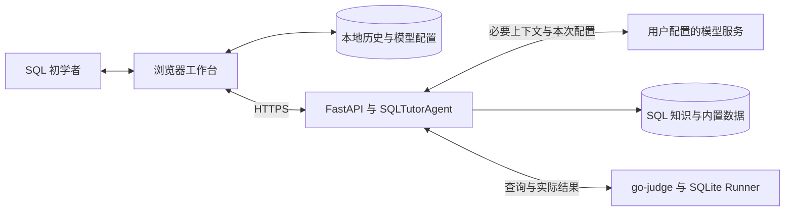
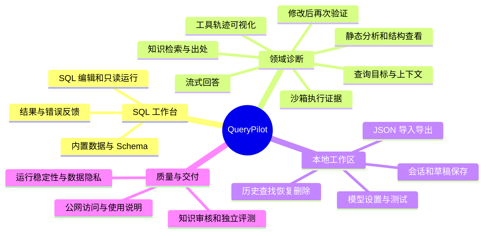
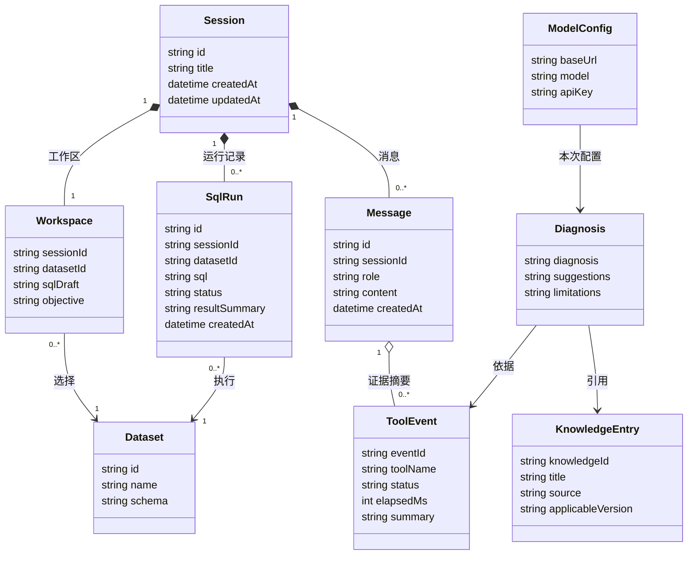

# QueryPilot 软件需求规格说明书

## 1 引言

### 1.1 目的

本文规定 QueryPilot 的功能、接口、运行约束及验收条件，供产品、开发与测试人员共同使用。

### 1.2 范围

QueryPilot 是面向数据库课程学生和初级开发者的 SQL 学习与诊断 Web 应用。用户可在浏览器中查看内置数据集的结构，编写并运行 SQLite 只读查询，也可调用 Agent 结合任务目标、执行结果和领域知识来解释问题，随后自行修改并再次验证。

SQL 工作台直接向访问者开放，诊断功能则使用用户个人的模型服务配置。会话与草稿保存在当前浏览器中，历史记录可通过 JSON 文件手动迁移。产品围绕内置数据集上的查询调试展开，并配套离线评测以检验诊断效果。

### 1.3 定义、简写和缩略语

本文中的 Agent 指 SQLTutorAgent，通过领域指令和工具处理 SQL 学习与诊断任务。Schema 指数据集的表、字段、类型及表间关系。AST 指 SQL 解析后的抽象语法树，用于静态检查。

工作区包含当前数据集、SQL 草稿和查询目标，会话用于保存相关消息、运行记录及工具事件，其中工具事件由后端根据实际调用生成。“执行成功”仅表示 SQLite 顺利完成查询，而判断“逻辑正确”还需结合明确的任务目标和可核对的结果。

SQL 指结构化查询语言，SQLite 是本产品的执行引擎，CTE 指公用表表达式。Endpoint 指模型服务地址，API Key 是用户个人的调用凭据。JSON 是接口通信及历史文件使用的数据格式，SSE 指服务端事件流，HTTPS 用于公网加密通信。token 是模型计量输入与输出的单位，其分词方式和计费规则取决于所选的模型服务。

### 1.4 引用文件

本文未引用外部文件。

### 1.5 综述

第 2 章介绍产品环境与使用条件，第 3 章规定具体需求，第 4 章给出验收操作与预期结果。

## 2 总体描述

### 2.1 产品描述

QueryPilot 是一款独立的 Web 应用。浏览器端负责编辑、展示和本地存储，后端负责编排模型与领域工具以完成诊断，SQL 沙箱提供查询运行环境。

*图 2-1 产品环境与请求流向*

#### 2.1.1 系统接口

系统连接浏览器本地存储、用户配置的模型服务及内部 SQL 沙箱。浏览器端提交当前任务，模型服务返回回答或工具调用请求，沙箱返回实际执行结果。

#### 2.1.2 用户界面

用户主要在 SQL 工作台中操作，可通过历史页面继续先前的学习过程，并在设置页面配置个人模型服务。诊断文本、执行结果和工具轨迹均在同一工作台中呈现。

#### 2.1.3 硬件接口

用户设备提供浏览器所需的输入、显示和网络能力，交互通过键盘、鼠标或触控完成。

#### 2.1.4 软件接口

浏览器通过应用 API 访问后端，并使用 IndexedDB 和 localStorage 保存本地数据。后端读取内置数据集与知识库，并调用模型服务和沙箱服务。

#### 2.1.5 通信接口

公网请求通过 HTTPS 传输，普通接口响应采用 JSON 格式，诊断过程采用 SSE 流式传输。后端与沙箱仅在内部网络中通信。

#### 2.1.6 内存约束

后端仅在单次请求期间持有任务上下文，SQL 沙箱设有内存上限，浏览器历史记录受限于站点存储容量。

#### 2.1.7 操作

用户选择数据集并查看 Schema，输入查询目标和 SQL 后执行查询。若遇到报错或结果与目标不符，可发起诊断，参考诊断解释及工具证据修改 SQL，并再次运行以核对结果。

学习过程随会话保存在本地。用户可从历史记录中检索并恢复工作区，也可将历史导出为文件，在其他浏览器中手动导入。

#### 2.1.8 现场适应性需求

部署时需配置公开域名、HTTPS 及沙箱服务连接。发布说明需列出实际支持的浏览器、模型及运行环境，供用户据此准备访问设备和个人模型配置。

### 2.2 产品功能

工作台集成了 SQL 编辑、结构查看与只读运行功能。Agent 通过静态分析、结构查看、沙箱执行和知识检索获取诊断依据，用户可查看工具调用轨迹并继续修改验证。模型设置、本地历史管理、JSON 迁移和流式回答共同支撑这一学习过程，配套的离线评测则用于检验领域定制效果。

*图 2-2 功能思维导图*

### 2.3 用户特点

数据库课程学生通常已接触基础 SELECT 语句，但对报错信息、NULL、连接和聚合的理解尚在形成。初级开发者能够编写简单查询，但常遇到查询虽能运行却难以判断结果是否正确的问题。两类用户都需要看懂表结构、理解修改原因，并核对实际执行结果。

用户应具备基本的浏览器操作能力，并能用自然语言描述查询目标。发起 Agent 诊断时，需自行准备可用的个人模型配置。

### 2.4 约束

产品的查询对象限于内置数据集，执行范围限于 SQLite 只读查询。后端按单次请求组织 Agent 任务，用户会话状态保存在浏览器端，静态数据、知识库和应用配置由部署环境管理。

模型服务需采用兼容 Chat Completions 的接口，并具备工具调用能力。SQL 执行由后端统一调用沙箱完成。

### 2.5 假设和依赖关系

软件依赖浏览器的 JavaScript、IndexedDB 和 localStorage。历史记录默认在当前设备与浏览器中使用，清除站点数据、使用隐私模式或存储配额限制均会影响数据的保存与恢复。Agent 依赖模型服务的网络连通性、调用额度与工具调用能力，SQL 运行依赖 go-judge 服务和 SQLite 执行环境。内置数据集和知识库随发布版本一并提供。

### 2.6 需求分配

前端负责交互和本地数据管理，后端负责接口请求处理与 Agent 编排，沙箱负责 SQL 执行，知识库与评测材料用于检验诊断质量。

## 3 具体需求

### 3.1 外部接口需求

#### 3.1.1 用户界面

工作台位于 `/`，提供数据集选择、Schema 查看、SQL 编辑、查询目标输入、运行结果展示和 Agent 对话功能。“直接运行”与“请求诊断”需提供清晰可辨的独立入口，且直接运行 SQL 无需配置模型。Schema、编辑与结果、对话区域可分区展示，窄屏下通过折叠或标签切换访问各区域。

`/history` 页面提供会话列表、关键词检索、恢复、删除及历史导入导出入口。`/settings` 页面提供模型配置、保存、兼容性测试和清除入口。

核心入口应支持键盘访问。加载、保存和错误状态需同时辅以文字说明，以便用户了解当前进展及可采取的操作。

#### 3.1.2 硬件接口

页面接收键盘、鼠标或浏览器支持的触控输入，并通过设备屏幕显示 SQL、执行结果与诊断内容。

#### 3.1.3 软件接口

##### 3.1.3.1 应用 API

系统提供以下五个 API 及对应的 OpenAPI 描述，明确定义请求字段、响应类型、状态码和错误格式。

*表 3-1 应用 API 输入输出*

| 接口 | 主要输入 | 主要输出 |
| --- | --- | --- |
| `GET /api/health` | 无请求体 | 服务健康状态 |
| `GET /api/datasets` | 无请求体 | 内置数据集元信息及工作台所需的 Schema |
| `POST /api/sql/run` | 数据集标识、SQL | 实际结果、执行状态、错误和耗时 |
| `POST /api/agent/chat` | 模型配置、工作区和必要消息 | 流式文本、最终诊断、证据、建议、引用、限制和工具事件摘要 |
| `POST /api/model/test` | Endpoint、模型 ID、Key | 连通、认证、模型可用性及工具兼容性结果 |

诊断请求中，`model_config` 包含 `base_url`、`model` 和 `api_key`，`workspace` 包含 `dataset_id`、`sql` 和 `goal`，`messages` 携带本次问题及相关历史消息。直接运行请求仅提交 SQL 和数据集标识。

当提交空 SQL 或未知数据集时，接口应返回明确提示。响应需区分 SQL 错误、服务故障、模型认证失败、工具不兼容和执行超时，前端据此说明问题原因及处理方式。

##### 3.1.3.2 模型服务接口

模型服务采用兼容 Chat Completions 的接口，接收请求级模型配置、必要上下文和函数工具定义，返回文本或工具调用请求。后端解析工具参数并执行后，将真实结果回传给模型以继续完成本次诊断。模型兼容性测试要求见 3.2.4。

##### 3.1.3.3 沙箱服务接口

FastAPI 通过内部 HTTP 接口调用 go-judge 的 `POST /run`，提交 Runner、内置数据集和用户 SQL。该接口返回执行状态、输出、错误与耗时，由后端转换为应用响应。

#### 3.1.4 通信接口

前后端通过 HTTPS 通信。普通接口交换 UTF-8 编码的 JSON 数据，Agent 流式回答使用 SSE，事件内容以 JSON 格式表示。后端通过内部 HTTP 接口调用沙箱服务。

流式连接的事件顺序、中断和终止处理见 3.2.8。

### 3.2 系统特征

#### 3.2.1 SQL 编辑与运行

##### 3.2.1.1 特征说明/目的

支持用户对照表结构编写查询，并通过实际执行结果判断下一步修改方向。

##### 3.2.1.2 激励/响应序列

用户选择数据集并输入 SQL，点击运行后，系统在沙箱中执行查询并显示结果或错误。

##### 3.2.1.3 相关的功能需求

###### 3.2.1.3.1 内置数据集与 Schema

系统至少提供 `company` 和 `school` 两组内置数据，分别覆盖“员工与部门”、“学生与课程成绩”等查询场景。Schema 展示表、字段、类型、关系和少量样例，内容与实际执行数据保持一致。切换数据集后，后续运行和诊断均使用新数据集，同时保留已有的 SQL 草稿。

###### 3.2.1.3.2 SQL 编辑与草稿保存

编辑器提供 SQL 语法高亮和基本编辑操作。当前数据集、SQL 草稿和查询目标关联至当前会话，并在编辑后自动保存。界面根据本地写入结果实时显示“正在保存”、“已保存”或“保存失败”。

###### 3.2.1.3.3 执行结果与状态反馈

执行结果包含真实列名、行数据、状态和耗时。界面需区分“执行成功但无记录”、SQL 错误、执行超时和通信失败。NULL 值与字符串 `"NULL"` 须分别显示，数值展示应保留精度，若发生必要的类型转换需向用户说明。

当结果超过返回数量上限时，需标明截断情况和实际返回行数。运行记录绑定提交时的会话、SQL 和数据集，即使在运行期间切换会话或继续编辑，返回的响应仍归入原请求。

#### 3.2.2 Agent 诊断与再次验证

##### 3.2.2.1 特征说明/目的

由 Agent 解释 SQL 报错或结果偏差的原因，并提供可核对的证据，帮助用户理解修改依据。

##### 3.2.2.2 激励/响应序列

用户提交问题和工作区内容后，Agent 检查信息是否充分，按需调用工具并返回解释。用户修改 SQL 后再次运行或请求验证，Agent 根据最新输入和证据继续判断。

##### 3.2.2.3 相关的功能需求

###### 3.2.2.3.1 任务与上下文处理

前端提交当前问题、SQL、数据集、查询目标和最近的相关消息，后端据此构建本次诊断上下文。对于长对话，仅选取与当前任务相关的历史消息，同时保留当前 SQL 和查询目标。

Agent 根据问题按需选择工具。若信息不足，应先说明当前已能检查的部分，再询问影响判断的目标、结构或预期结果。纯规则问题可以直接解释。当查询结果符合已知目标时，应认可该结果，并说明验证所依据的数据。

###### 3.2.2.3.2 领域工具调用

SQLTutorAgent 使用以下四类工具。

*表 3-2 领域工具输入输出*

| 工具 | 输入 | 返回内容 |
| --- | --- | --- |
| `inspect_schema` | 内置数据集标识 | 可用表、字段、关系和少量样例 |
| `analyze_sql` | SQL 文本 | AST 摘要、语句类型、静态错误和可疑用法 |
| `execute_sql` | SQL 和内置数据集标识 | 实际列、行、执行状态、错误及耗时 |
| `search_sql_knowledge` | 自然语言或关键词 | 相关片段、知识 ID、出处和适用范围 |

静态分析发现的可疑用法仅作为待验证提示，遇到解析器不支持的写法时，需标明分析限制。知识检索无匹配项时返回空结果。

工具调用失败时，需返回失败环节与已获取的证据，并在诊断中说明受影响的判断范围。

###### 3.2.2.3.3 诊断解释与证据引用

诊断使用中文说明问题、证据、修改建议和尚待验证的内容，解释当前 SQL 为何会产生该结果。语法错误、运行时错误、可能的逻辑问题和合理推测应清楚区分，所有证据均须对应实际的解析、Schema、执行或检索记录。

最终响应包含 `diagnosis`、`evidence`、`suggestions`、`knowledge_refs` 和 `limitations`，分别表示诊断结论、证据、修改建议、知识引用和验证限制。后端将实际工具调用写入 `tool_events`，包含工具名称、状态、耗时和结果摘要。

回答中凡标为“已执行”的查询，必须能找到对应的执行记录，未经运行的修复方案须标为“候选建议”。知识引用必须对应实际检索到的条目，并支持定位至相关规则和来源。

###### 3.2.2.3.4 修改与再次验证

修改建议以文字或候选 SQL 形式展示，由用户自行修改当前草稿。Agent 验证候选只读查询时，需明确展示所验证的 SQL 及实际执行结果。验证结论应限定在已知目标、数据和检查条件内，若预期结果尚不明确，需说明仍待确认的部分。

#### 3.2.3 知识检索与领域定制

##### 3.2.3.1 特征说明/目的

检索经审核的规则和示例，帮助用户理解诊断中涉及的 SQL 知识。

##### 3.2.3.2 激励/响应序列

Agent 提交检索词，系统返回相关片段、知识 ID 和来源。诊断回答引用匹配的条目，未检索到相关资料时，需说明当前知识依据有限。

##### 3.2.3.3 相关的功能需求

###### 3.2.3.3.1 知识条目与审核

知识内容来自公开技术资料、获准整理的课程教材和团队原创示例，建设目标为 15–20 个经审核的条目。条目需覆盖：基础查询（WHERE、ORDER BY、LIMIT）、NULL 与三值逻辑、聚合（COUNT、SUM、AVG、GROUP BY、HAVING）、连接（INNER JOIN、LEFT JOIN、连接条件与笛卡尔积），以及子查询、CTE、CASE 和典型错误。

每个条目包含稳定的 `knowledge_id`、标题、适用条件、规则解释、正确示例、典型误区、来源和适用 SQLite 版本。外部资料需记录名称、版本和可核对的位置，教材摘编须控制在获准使用的范围内。原创示例需标明所属数据集，且所有示例均应能在指定执行环境中复现。知识组需交叉审核规则、函数行为及边界条件，审核通过后方可纳入正式知识库。

###### 3.2.3.3.2 检索、定制与引用

领域定制采用专用指令、Markdown 知识整理、BM25 检索和工具编排。SQLTutorAgent 需结合检索规则与实际执行证据来解释问题，且所作引用应能定位到具体条目及其来源。

#### 3.2.4 模型配置与兼容测试

##### 3.2.4.1 特征说明/目的

支持用户选择受支持的个人模型服务，并在发起诊断前确认配置可用。

##### 3.2.4.2 激励/响应序列

用户填写并保存配置，发起兼容性测试并查看各项检查结果。完成配置后即可在工作台发起诊断，执行清除操作后，后续请求将重新进入待配置状态。

##### 3.2.4.3 相关的功能需求

###### 3.2.4.3.1 配置填写与本地保存

模型配置包含 Endpoint、模型 ID 和 API Key，保存在 localStorage 中，其中 Key 默认掩码显示。设置页面需说明：配置仅保存在当前浏览器且可随时清除，模型调用将消耗用户个人的额度。

###### 3.2.4.3.2 兼容性测试

系统支持兼容 Chat Completions 且具备函数工具调用能力的模型服务。兼容性测试需检查服务连通性、认证状态、所选模型可用性及工具调用兼容性，并分别展示各项检查结果。

###### 3.2.4.3.3 请求配置与清除

后端按单次请求传入的配置创建模型客户端，并在请求结束后释放临时上下文。清除配置后，新请求不再自动使用旧凭据。当缺少配置、认证失败或工具不兼容时，界面需说明原因和处理办法，同时保留当前工作区。

#### 3.2.5 本地会话与历史管理

##### 3.2.5.1 特征说明/目的

支持用户继续未完成的查询调试，或查找、恢复、删除过往的学习过程。

##### 3.2.5.2 激励/响应序列

用户编辑内容、发送消息或运行查询后，系统将其关联到当前会话。用户可从历史记录中检索并恢复会话，并在确认删除后移除关联记录。

##### 3.2.5.3 相关的功能需求

###### 3.2.5.3.1 会话检索、恢复与删除

历史列表支持关键词检索和重新打开会话。恢复会话时，系统还原已保存的数据集、草稿、查询目标、消息和运行记录，工具轨迹按 3.2.6 要求同步恢复。删除会话前需说明影响并经用户确认：确认后删除会话及其关联数据，取消则保留原记录。

“清空历史”与“清除模型配置”提供相互独立的操作入口，界面需分别说明各自的删除范围。

###### 3.2.5.3.2 持久化边界与失败处理

完整历史保存在 IndexedDB 中，数据逻辑关系见 3.6.1。当本地保存失败时，需保留页面中的当前内容，并提示“尚未保存”。

#### 3.2.6 工具轨迹展示

##### 3.2.6.1 特征说明/目的

通过工具轨迹让用户直观了解诊断过程获取了哪些证据，以及哪些检查遇到了问题。

##### 3.2.6.2 激励/响应序列

诊断进行时，工作台按实际事件实时更新工具状态。用户重新打开历史会话后，可查看已保存的调用摘要。

##### 3.2.6.3 相关的功能需求

###### 3.2.6.3.1 真实轨迹展示与恢复

轨迹需显示后端产生的真实工具名称、成功或失败状态、耗时及结果摘要，并随会话保存和恢复。展示范围限于工具调用信息，排除模型的私有推理过程和用户凭据。

#### 3.2.7 历史导入导出

##### 3.2.7.1 特征说明/目的

支持用户通过 JSON 文件备份和手动迁移学习历史。

##### 3.2.7.2 激励/响应序列

用户导出历史文件或选择本地文件导入。系统检查文件合法性后完成迁移，遇到错误时说明原因并保留原有记录。

##### 3.2.7.3 相关的功能需求

###### 3.2.7.3.1 历史文件处理

历史文件采用 JSON 格式，包含会话、消息、草稿、运行摘要和工具摘要。导出时需提示用户文件可能包含个人 SQL 和对话内容，且模型配置保存在历史文件之外。

导入后需保持会话及相关记录之间的关联关系。当文件格式错误或本地保存失败时，应说明原因并确保已有历史记录保持完整。

#### 3.2.8 流式回答

##### 3.2.8.1 特征说明/目的

支持用户在等待诊断时逐步阅读回答、观察工具进展，并了解本次任务是否完成。

##### 3.2.8.2 激励/响应序列

提交诊断后，界面依序接收文本增量和工具事件。收到最终诊断事件时结束生成状态，收到请求错误或发生连接中断时，保留已显示内容并标明状态。

##### 3.2.8.3 相关的功能需求

###### 3.2.8.3.1 流式事件与终止处理

SSE 事件按请求关联并严格保持顺序，区分文本增量、工具事件、最终诊断和请求错误。单次工具调用失败可作为诊断证据的一部分继续流程，整个工作流的完成情况以请求终止事件为准。

后端为每个请求仅发送一个终止事件，正常成功时包含完整的结构化诊断。客户端收到请求错误或发现连接中断时，需将当前内容标为“失败”或“未完成”并按该状态保存，同时允许用户重新发起请求。

### 3.3 性能需求

#### 3.3.1 容量与资源上限

SQL 执行需设置时间、内存和结果数量上限，模型请求需设置超时时间。具体数值采用部署配置，并记录在部署说明中。浏览器保存的历史容量受站点存储配额限制。

#### 3.3.2 反馈与超限响应

当执行超时或达到内存上限时，系统应结束本次运行并提示原因，用户可继续编辑或重新运行。

#### 3.3.3 响应时间与测量条件

测试需在实际部署环境中记录数据集接口、普通 SQL 查询和 Agent 诊断的耗时，并说明环境配置与数据规模。模型服务的等待时间需单独记录，以便区分上游响应时间与应用处理时间。

### 3.4 设计约束

#### 3.4.1 标准依从性

SQL 的执行语义以发布版本使用的 SQLite 引擎为准，静态解析、知识示例和评测结果均应与该版本的执行行为一致。API、前端页面及历史文件中的字段类型、状态和标识需遵守统一约定，确保接口描述与实际行为一致。

#### 3.4.2 技术与部署约束

前端使用 React、TypeScript、Vite、React Router、Tailwind CSS、shadcn/ui 和 Monaco，并使用 Dexie 管理 IndexedDB。后端使用 Python、FastAPI、Pydantic 与 OpenAI Agents SDK，SQL 静态分析采用 SQLGlot，沙箱执行采用 go-judge 和 SQLite。知识检索使用 Markdown、BM25、rank-bm25 和 jieba，服务间请求使用 HTTPX。

部署采用 Docker Compose 和 Caddy。后端按请求处理用户任务，服务端仅保存内置数据、知识库与应用配置，个人会话和 SQL 历史保存在浏览器端。

#### 3.4.3 执行与隔离约束

SQL 执行范围限于内置数据集上的单条只读 SELECT 查询（包含以 SELECT 为最终语句的 CTE）。前端直接运行和 Agent 的 `execute_sql` 工具共用同一后端执行服务。

Runner 在沙箱内加载内置数据并执行查询，每次运行均从相同的初始数据开始，执行完成后释放临时环境。模型配置仅用于后端调用模型，SQL 运行仅使用数据集标识和查询内容。

### 3.5 软件系统属性

#### 3.5.1 可靠性

异步返回的结果须准确对应提交时的请求和会话，保存状态需反映实际的本地写入结果。诊断、工具调用及 SQL 执行响应需保留可核对的成功或失败状态。发生局部失败时，需说明已获取的证据和剩余限制。

#### 3.5.2 可用性

当网络、模型、沙箱或浏览器存储不可用时，界面需指出故障位置及当前仍可进行的操作。模型服务故障时，SQL 编辑和直接运行功能继续可用（直接运行以沙箱服务正常为前提）。

应用重启后继续使用同版本的内置数据，浏览器中已保存的会话仍可正常恢复。请求失败时需保留当前工作区，方便用户排除故障后继续操作。

#### 3.5.3 安全保密性

模型配置由用户在浏览器中自行保存和清除，后端仅在处理本次请求时使用 API Key。严禁将 API Key 写入服务端日志、会话历史、工具轨迹或导出文件。

#### 3.5.4 可维护性

交付版本需记录软件依赖、SQLite、数据集及知识库的版本号，接口描述、配置说明和部署步骤需随变更同步更新。知识条目须保留稳定的 ID，示例 SQL 与评测案例应支持重复执行。当接口或数据语义发生变化时，需同步检查相应需求和验收案例，主要代码须经过审查及适当测试。

#### 3.5.5 可移植性

前端支持发布说明列出的浏览器，后端与沙箱部署在 Linux 环境。交付说明需列明环境依赖、版本和配置，确保具备相同条件的环境能够按步骤复现。

### 3.6 其他需求

#### 3.6.1 数据库逻辑需求

IndexedDB 中的 `sessions`、`messages`、`sqlRuns`、`workspaces` 和 `toolEvents` 分别保存会话、消息、运行记录、工作区及工具事件记录。会话包含唯一 ID、标题、创建时间和更新时间。消息通过会话 ID 关联，保留角色、内容、时间和完成状态。

每个会话对应一个当前工作区，保存数据集、SQL 草稿、查询目标及更新时间。运行记录保存提交时的数据集、SQL、执行状态、结果摘要和时间。工具事件关联所属会话及对应消息，保存工具名称、状态、耗时与结果摘要。

各类记录的标识应唯一，关联关系应完整。删除会话时需一并删除相关数据，历史文件导入后也须保持同样的关联规则。模型配置独立保存于 localStorage 中，历史对象及其导出字段仅限于上述学习记录。

*图 3-1 业务对象概念类图*

类图中的 `ModelConfig` 为独立设置，仅随单次请求提供模型参数。

#### 3.6.2 独立评测与定制效果

离线评测需准备约 30 个案例，总量划分为开发集与最终留出集。案例需覆盖语法与列名、WHERE 和 NULL、JOIN、聚合、子查询与 CTE、排序，以及正常查询和信息不足的输入场景。每个案例记录任务描述、SQL、数据集及 Schema、人工确认的关键问题或正确结论、可接受的解释，以及适用的知识 ID 和预期工具证据。评测报告需说明各类别的数量与覆盖情况。

提示词和知识库调整仅使用开发集，在正式测试前须固定留出集案例、预期答案与评分规则。凡用于演示或调优的案例均归入开发集，最终留出集结果用于报告领域定制效果。

对照实验使用同一基础模型：A 组仅提供任务和 SQL；B 组增加静态解析及实际执行反馈；C 组使用完整领域指令并按需调用四类工具。各组需保持基础模型、采样参数、输入案例和输出长度上限一致，确有差异时须在报告中列明；B、C 两组使用相同的执行数据和资源限制。

评测采用预先制定的 0/1 或 0–2 分量表，由至少两人独立评分，存在争议时交由知识组复核。评测需比较错误类型识别准确率、解释正确率、建议可执行率、知识引用有效率、无依据断言率和工具成功率，并记录响应延迟与模型 token 用量。每项指标需注明适用案例范围及分母，不适用时单独标注。“引用缺失”与“引用错误”需分别记录，“SQL 执行返回错误”与“工具基础设施故障”需分别统计，“建议能否执行”与“执行结果是否符合任务目标”也应分开判断。

报告需保留超时、空回答、失败和重试记录，并展示典型案例的原始输出、工具证据及评分依据。结果须如实呈现改进、持平或退化的情况，准确率、延迟和费用仅填写实际测得的数据。

#### 3.6.3 上线与交付要求

产品通过公网 HTTPS 上线，并提供访问地址、可复现的前后端及沙箱部署步骤、快速入门、模型配置与支持范围、故障排查、隐私说明和演示路径。直接运行功能供访问者直接检查，诊断功能使用检查者本人的模型配置。

交付材料包含知识审核记录、结构化评测案例、评测运行方式和真实评测报告。验收记录需标明发布版本、环境、操作、预期与实际结果，并附带实际运行证据。

## 4 验收

验收使用正式发布版本及对应的数据集和知识库版本，按以下操作逐项核对结果。

### 4.1 工作台与会话

在 `company` 和 `school` 数据集间切换，查看 Schema 并分别运行正常查询、空结果查询和错误查询。核对 Schema 是否与内置数据一致、结果及状态显示是否准确，以及未配置模型时能否直接运行查询。在查询运行中切换会话或编辑 SQL，核对响应是否仍归入提交时的原任务。

编辑草稿并完成对话和查询运行后刷新页面，应能恢复已保存的工作区、消息及运行记录。核对关键词检索能否打开对应会话，取消删除是否保留原数据，确认删除是否移除会话及全部关联记录。

测试保存、更换和清除模型配置，兼容性测试应准确反映连通、认证和工具支持情况，且后续请求使用当前最新设置。核对“清空历史”和“清除配置”是否分别独立生效。

### 4.2 诊断与领域知识

使用内置数据上的表连接、NULL、聚合和子查询任务发起诊断，检查四类工具是否按需调用。诊断解释、建议和知识引用应与实际证据一致，用户修改后可再次运行验证。正确查询应得到符合证据的肯定评价，信息不足或检查失败时应如实说明判断范围。

核对知识库的条目数量和覆盖范围，抽查资料来源、版本及审核记录并实际运行示例。核对条目信息是否齐全，示例运行结果是否符合所述规则。

### 4.3 工具轨迹、历史迁移与流式回答

对照后端实际调用核对前端轨迹，再刷新会话并执行历史的导出与导入。核对工具名称、状态、耗时及摘要是否一致，会话和相关记录是否保持完整关联。当导入文件格式错误或保存失败时应给出明确提示，且已有历史保持完整。

发起流式诊断，分别检查正常完成、单次工具失败和断线时的状态。文本与工具事件应按顺序显示，正常完成时包含完整结构化诊断。连接中断时应保留已有内容并标为“失败”或“未完成”，同时支持用户重新发起请求。

### 4.4 独立评测与定制效果

按 3.6.2 要求运行对照评测，抽查评分记录及指标计算。核对案例划分和评分依据是否清晰，报告数据能否追溯至原始输出与工具记录，且失败和重试情况是否完整保留。

### 4.5 异常与安全

运行空 SQL 和超出只读范围的语句，并模拟执行超时、模型或沙箱不可用、本地保存失败和浏览器断线等异常。界面应提示原因并保留当前工作区，本地保存失败时应明确显示“未保存”。

核对服务端日志、本地历史、工具轨迹和导出文件，确认均未包含模型 API Key。

### 4.6 上线与交付

从外部网络通过 HTTPS 访问系统，按快速入门完成 SQL 直接运行及使用个人模型配置的诊断。按交付步骤在 Linux 环境复现部署，并核对 3.6.3 要求的交付材料。确认服务可正常使用、材料齐备、演示操作可重复完成。
