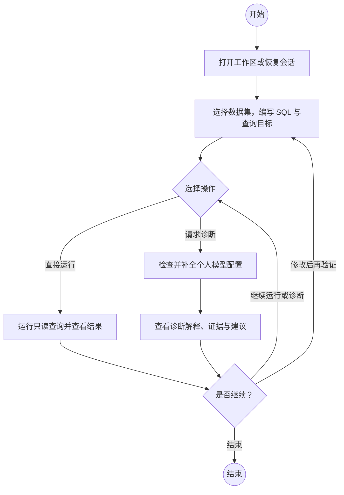
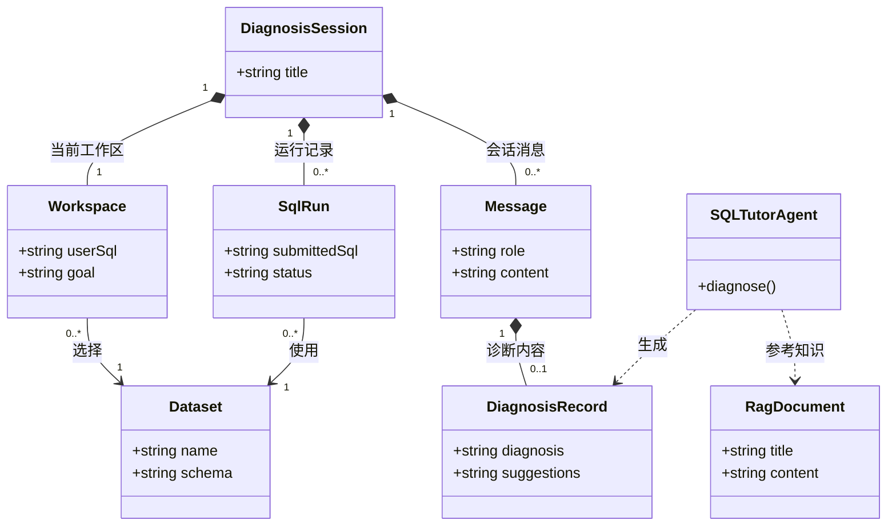
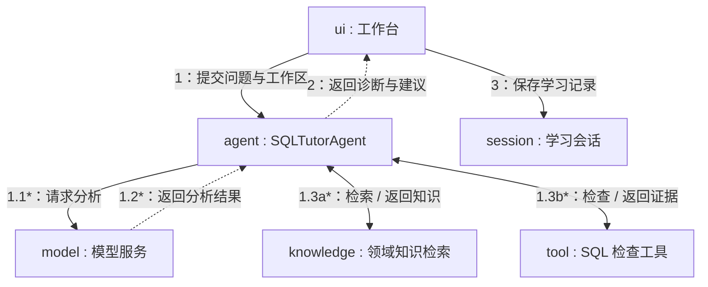
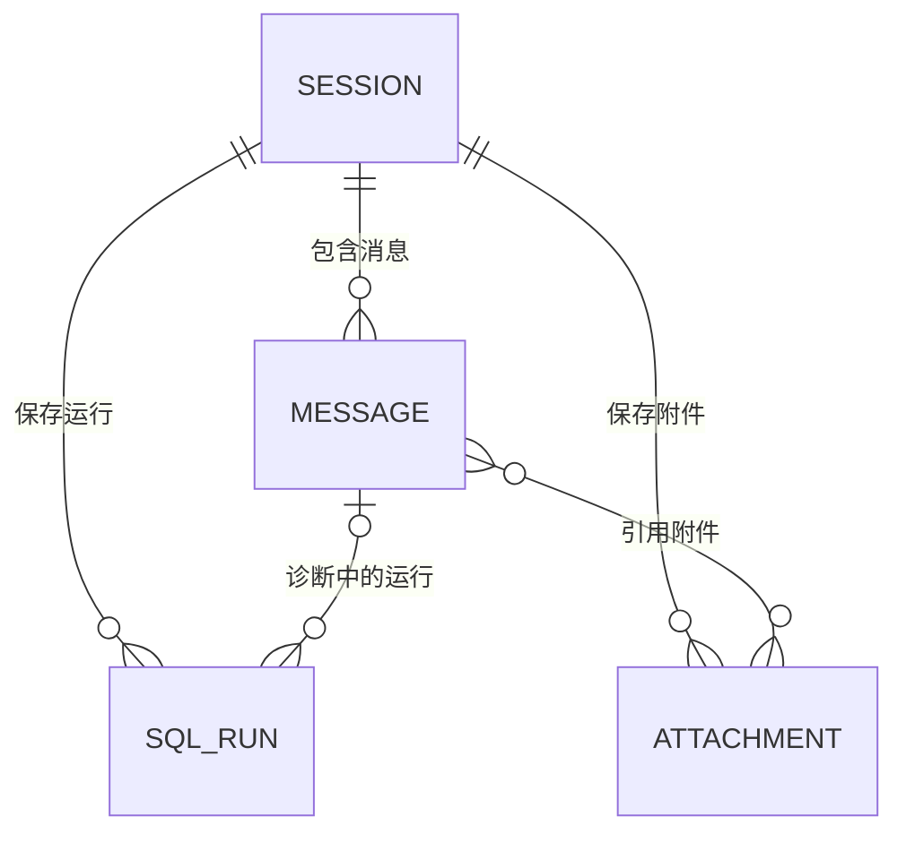
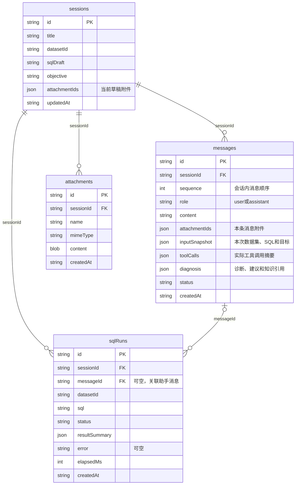
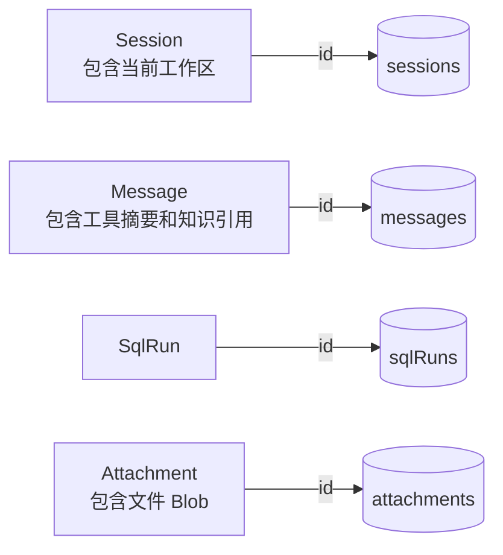

| 作业所属课程 | [H202601软件工程与软件工程实践](https://edu.cnblogs.com/campus/fzu/2026-01SoftwareEngineeringandSoftwareEngineeringPractice) |
| :---- | :---- |
| 作业要求 | [2026秋软工实践团队作业-第二次（原型设计+概要设计）](https://edu.cnblogs.com/campus/fzu/2026-01SoftwareEngineeringandSoftwareEngineeringPractice/homework/16774) |
| 作业目标 | 在第一次团队作业需求分析的基础上，完成系统原型设计、UML 概要设计和数据库设计，体现领域 Agent 与系统的集成，形成规范的设计文档，并通过 GitHub 协作、团队开发计划及博客展示项目设计成果。 |
| 团队名称 | 组长说的都队 |
| 团队成员 | 任宝硕、黄亦博、吴莉芊、陈果、陈铮、向飞燕 卓滢、郭航铭、吴昊阳、颜志航、林烨、曾子瑞 |
| GitHub 仓库 | [renbaoshuo/202601-software-engineering-lab](https://github.com/renbaoshuo/202601-software-engineering-lab) |

## 原型设计

QueryPilot 是一个面向 SQL 学习者、数据分析师和研发人员的 SQL 诊断工作台。原型围绕 SQL 诊断的实际使用过程展开，用户可以提交题目背景和 SQL 草稿，由 Agent 调用相关工具完成分析，再根据诊断建议修改 SQL 并重新验证。

整个工作台采用三栏布局。左侧管理历史会话，中间负责当前任务的输入、对话和诊断结果展示，右侧则用来查看工具调用详情、SQL 测试结果和相关知识。

中间区域是主要的交互入口。Agent 的回复、工具执行过程和诊断结果会按照实际发生的顺序出现在对话中。右侧面板平时保持收起，需要查看具体信息时再展开，这样在阅读诊断结果时也能有比较完整的空间。

### 任务创建与 Agent 诊断

新建会话时，用户需要填写题目背景，也可以补充自己的 SQL 草稿和测试数据说明。其中题目背景是必填内容，其余内容可以根据实际情况选择填写。

初始页面会先展示任务输入区域，引导用户提供需要解决的 SQL 问题。

如果题目背景还没有填写，「开始对话」按钮会保持置灰状态。尝试提交时，输入框会标红，同时显示相应的必填提示。

为了方便快速体验，页面也提供了「填入示例」功能，可以自动填充题目背景、SQL 草稿和示例数据集说明。

提交任务后，按钮会进入加载状态，暂时禁止重复提交。提交成功后，页面直接进入对话，并在顶部显示当前任务的简要信息。

进入对话后，Agent 会根据任务内容调用相应的 SQL 工具。原型主要涉及表结构查询 `inspect_schema`、SQL 静态分析 `analyze_sql`、沙箱执行 `execute_sql` 和知识库检索 `search_sql_knowledge`。

这些工具会按照诊断需要依次执行。界面将工具调用记录直接嵌入 Agent 的回复中，用户可以看到当前正在执行哪个工具，以及已经完成的调用。

工具执行时也可能遇到错误。例如沙箱执行 SQL 失败后，对应的调用记录会显示错误状态，Agent 仍然可以继续使用其他工具获取信息。这样用户能够看到实际的执行过程，也能知道某条诊断依据来自哪个工具。

工具调用完成后，点击对应的调用记录，右侧面板会自动展开，并显示这次调用的详细内容。

在工具执行和诊断生成的过程中，诊断区域会先展示等待或生成状态。等到相关处理完成，再显示完整的诊断结果。

诊断结果以卡片形式展示，内容包括问题与原因、相关证据、修改建议、知识引用和验证限制。

其中，问题与原因负责说明 SQL 出错的位置及原因，证据部分会引用工具返回的结果或实际报错。修改建议则提供对应的 SQL 示例，方便用户直接复制和调整。

知识引用会关联相关的 SQL 规则，验证限制则用于说明当前已经确认的内容，以及还有哪些部分需要进一步验证。

### 知识联动与修改验证

诊断结果中的知识引用设计成了可以点击的标签。例如点击 `SQL-014`，右侧面板会自动打开并切换到知识区域。

知识面板会展示具体的规则说明、适用范围、错误与正确示例，以及规则出处。

用户可以直接对照诊断结果查看这些内容，了解当前 SQL 为什么会出现问题，或者某种修改方式适用于什么情况。

除了知识内容，右侧面板还提供 SQL 测试、调用详情和文件查看功能。这些信息都集中在同一块辅助区域中，通过顶部 Tab 切换。

例如在 SQL 测试页面中，可以查看相关的 SQL 内容和测试区域。在文件页面中，则可以查看与当前任务相关的文件。

右侧面板也会与中间的对话内容联动。点击工具调用记录时，可以直接定位到对应的调用详情，查看工具的执行信息。

完成诊断后，用户可以根据建议修改 SQL，然后在当前会话中重新提交。

重新提交会触发新一轮验证，界面继续通过对话内容和结果卡展示执行过程。

如果修改后的 SQL 通过验证，结果区域会明确显示「验证通过」，并展示对应的执行结果。

如果 SQL 仍然存在问题，结果卡则会显示「仍有问题」。用户可以继续查看这次验证的结果，再进行下一次修改。

整个过程都保留在当前对话中。之前的诊断记录可以向上查看，新一轮验证主要展示当前的执行情况和结果，方便连续修改同一个 SQL 问题。

### 模型配置与异常状态

模型配置入口放在工作台顶部的模型标签和新建任务页面中。点击后会打开配置弹层，用户可以接入自己的模型服务。

配置内容主要包括 API Endpoint、API Key、Model ID、Context Length 和 Max Output Tokens。

填写完成后，可以先通过「测试连接」检查当前模型服务是否能够正常使用。

测试连接会根据实际结果显示成功或失败反馈。如果连接失败，用户可以继续检查并修改填写的参数。

保存配置后，工作台上的模型标签会同步更新。配置数据保存在本地，API Key 也由本地管理。

为了保持同一个会话中的模型环境一致，对话开始后会锁定当前使用的模型。如果需要更换模型，可以在新建会话时重新选择。

SQL 诊断中还会遇到一些常见的异常情况，因此原型也设计了对应的状态反馈。

查询执行部分包括空结果、语法错误和运行超时等情况。不同状态使用不同的颜色和文字提示，让用户能够区分当前的问题。

连接失败和模型服务不可用也有相应的反馈。工具执行失败、诊断生成中以及按钮不可用等状态，则会在对应的操作位置显示。

这些状态统一使用 `StatusBadge` 组件，通过颜色、图标和文字一起展示。对于能够继续处理的问题，界面也会提供重试、查看详情或重新请求诊断等操作。

### 会话管理与后续提问

会话历史统一放在工作台左侧。用户可以搜索之前的会话，重新打开已有任务，也可以删除记录，或者通过 JSON 文件导入和导出会话数据。

历史会话的检索由工作台直接完成，打开记录后就可以继续查看之前的 SQL 诊断内容。

对于已经进入对话的任务，底部会保留追问输入框。用户可以结合当前的诊断结果继续提问，例如询问某条 SQL 规则、补充新的条件，或者提交调整后的 SQL。

追加提问后，Agent 会继续处理当前问题，并根据需要重新调用相关工具，新的分析过程和诊断结果也会接着显示在对话中。

原型中的交互状态、页面内容和组件关系都整理在 Figma 中。各个流程包含对应的操作过程、系统反馈和结果页面，也附有操作行为、系统响应、呈现结果及设计意图的说明。

[在 Figma 上查看 QueryPilot 在线原型](https://www.figma.com/design/T2Il1hLsQ5YorgBLaMK5Xl/QueryPilot-%E5%8E%9F%E5%9E%8B%E5%B1%95%E7%A4%BA?node-id=0-1&t=dxeD8FLF4BSNAJws-1)

## 概要设计

### UML 设计

**业务流程**

用户打开工作区或恢复已有会话后，选择数据集，编写 SQL 和查询目标。接下来可以直接运行查询，也可以请求诊断。用户根据查询结果、诊断解释和修改建议调整 SQL，再次运行或请求验证，形成持续的学习与调试过程。

直接运行 SQL 不需要配置模型，请求诊断时则使用用户的个人模型配置。诊断结果会提供问题解释、相关证据和修改建议，用户可以自行决定是否采纳。修改后的 SQL 仍然需要通过实际运行或再次诊断来验证。

**核心类关系**

系统以学习会话（DiagnosisSession）组织工作区、消息和 SQL 运行记录。工作区（Workspace）保存当前 SQL、查询目标和所选数据集，消息（Message）用于记录会话中的交互内容，诊断结果（DiagnosisRecord）则作为消息的一部分保存。

其中，Dataset 表示系统提供的内置数据集，保存数据集名称和表结构信息。SqlRun 记录用户提交的 SQL 及其运行状态，便于在会话中查看之前的查询操作。

SQLTutorAgent 负责生成诊断结果，诊断过程中可以参考 RagDocument 中的 SQL 领域知识。领域知识主要包含 SQL 规则和相关案例，用于辅助解释查询问题。诊断内容与普通会话消息关联保存，方便用户回顾之前的问题和修改建议。

**对象交互**

以一次 SQL 诊断为例，工作台向 SQLTutorAgent 提交当前 SQL、查询目标和相关问题。Agent 通过模型服务分析问题，并根据需要检索领域知识或调用 SQL 检查工具，最后将诊断解释和修改建议返回工作台。

模型服务负责分析 SQL 问题，领域知识检索提供相关规则和案例，SQL 检查工具则负责获取表结构、分析语句或执行只读查询，为诊断提供实际证据。

Agent 可以根据当前问题多次调用模型服务，也可以按需使用知识检索和检查工具。图中的消息编号用于表示主要交互关系，星号表示可能重复的调用，a、b 表示可以按需选择的检查路径。

诊断完成后，工作台展示分析结果，并将相关内容保存到学习会话中。用户可以继续修改 SQL、查看运行结果或发起新的诊断，之前的消息和运行记录也会保留在对应会话中。

### 数据库设计

QueryPilot 面向正在学习 SQL 的学生和初级开发者。用户在使用时，往往会先在一个数据集的基础上，编写 SQL 并查看执行结果。如果遇到报错，或者结果和自己的预期不一致，就可以向 Agent 描述问题，再根据诊断建议修改 SQL、重新运行。这个过程通常需要反复尝试，所以系统需要保存草稿、对话和每次运行的结果，方便用户继续之前的调试，也方便回头查看自己改了什么、为什么要这样改。

这些记录主要是由用户在当前浏览器中使用的，因此我们将其统一保存在浏览器的 IndexedDB 中。用户刷新页面或重新打开会话后，就可以恢复之前的 SQL 草稿、查询目标和对话内容。而后端则负责处理本次诊断和 SQL 执行，并提供内置数据集与知识库。这样，用户的个人历史由客户端保存和管理，后端是无状态的。

保存时，需要区分「现在正在编辑的内容」和「当时提交的内容」。当前草稿会随着用户编辑而更新，而每次诊断使用的数据集、SQL 和查询目标会另外保存下来。这样，用户后来继续修改 SQL，也能看清之前的回答针对的是哪一版 SQL。实际工具调用的摘要和执行结果也会随历史保存，用户回看时可以结合这些结果理解诊断建议。

数据按会话组织，一次查询调试中的消息、运行记录和附件都放在同一个会话下。用户可以重新打开会话继续操作，也可以删除整个会话，或者导出后在其他浏览器中导入。

**ER 图**

ER 图以会话为中心，一个会话可以包含多条消息、SQL 运行记录和附件。Agent 发起的 SQL 运行关联到对应的助手消息，手动运行不关联消息。附件归属于一个会话，可被当前草稿和同会话中的多条消息引用。

**关系数据模型**

关系数据模型包含 sessions、messages、sqlRuns 和 attachments 四个对象仓。各记录以 id 为主键，消息、运行记录和附件通过 sessionId 关联会话。

sessions 保存标题、数据集、SQL 草稿和查询目标。messages 保存消息内容、顺序和诊断输入快照，工具调用摘要与知识引用嵌入消息。sqlRuns 保存实际执行的 SQL、数据集、状态、结果摘要、错误信息和耗时，通过可为空的 messageId 关联助手消息。attachments 保存文件名、类型和 Blob 内容。

**对象与库表映射**

Session、Message、SqlRun 和 Attachment 四个 TypeScript 实体类型分别映射到 sessions、messages、sqlRuns 和 attachments 对象仓，字段按同名保存。嵌套对象和数组直接存储，附件元数据与文件内容放在同一条记录中。

### Agent 知识库设计

**知识库构建对领域 Agent 的优势**

在 QueryPilot 中，知识库主要为 Agent 提供可靠的 SQL 规则和课程知识，减少对模型自身知识的依赖。

知识库的优势主要包括：

1. 提高诊断准确性。通过官方文档和专业教材提供规则依据，减少模型对 SQL 语义、MySQL/SQLite/PostgreSQL 方言等内容的错误判断。
2. 减少模型幻觉。Agent 可以根据已审核的知识条目解释问题，避免生成缺乏依据的结论。
3. 提高可解释性。知识条目保留来源、版本和具体位置，用户可以查看诊断结论所依据的文档或教材。
4. 方便维护和扩展。SQL 规范或课程要求发生变化时，可以直接更新知识条目，无需重新训练模型。

**知识库计划构建来源**

我们的知识库主要收集 SQL 语法、语义规则、SQLite 方言差异及常见错误知识，计划从以下公开资源中提取和整理内容。

1. **SQLite 官方文档**
   - https://www.sqlite.org/docs.html
   - 包含 SQL 语法、函数、数据类型及数据库约束等内容。计划下载完整 HTML 文档，按知识点拆分并提取规则。
2. **SQLite Syntax Diagrams**
   - https://www.sqlite.org/syntaxdiagrams.html
   - 提供 SELECT、JOIN、子查询等语法结构，用于整理 SQL 语法规则及子句之间的关系。
3. **SQLite Requirements**
   - https://www.sqlite.org/requirements.html
   - 包含从官方文档提取的行为规则及对应标识，计划筛选 SQL 语义、表达式求值和数据库约束相关内容。
4. **SQLite FAQ / Quirks / Error Codes**
   - https://www.sqlite.org/faq.html
   - https://www.sqlite.org/quirks.html
   - https://www.sqlite.org/rescode.html
   - 包含常见问题、SQLite 特有行为及执行错误说明，用于整理错误原因和处理方法。
5. **BIRD-CRITIC-1.0-SQLite**
   - https://huggingface.co/datasets/birdsql/bird-critic-1.0-sqlite
   - 包含 500 个 SQLite 调试案例，计划从中提取典型错误模式。由于公开版本缺少完整的修复 SQL 和测试用例，部分错误原因需要进一步分析和验证。

我们计划对上述来源进行内容提取、去重、分类和人工核验，最终形成规则类与错误类知识条目。规则类的知识主要记录基本的语法说明及其适用条件，错误类的知识主要记录错误模式、产生原因及修改方法，作为示例提供给 Agent 使用。

**领域知识在系统中的作用**

在 QueryPilot 中，知识库主要为 Agent 提供 SQL 领域知识支持，使系统不仅能够更加高效地发现 SQL 中的问题，还能更详尽地解释问题产生的原因，并给出有依据的修改建议。

对于用户而言，知识库的价值在于提升诊断结果的可信度和学习价值。用户不仅能知道 SQL 哪里写错了，还能了解相关的语法规则和正确用法。系统也可以提供对应的知识来源，方便用户进一步查阅和学习，避免用户只依赖修改后的答案。

知识库还能够帮助 Agent 识别常见错误模式，减少重复分析，提高诊断的一致性。相比单纯依赖大语言模型生成解释，引入经过整理和验证的领域知识，可以降低错误判断和不准确解释的风险。

### Agent 评测设计

**评测目标与对照实验**

QueryPilot 的评测主要关注 Agent 能不能准确定位 SQL 问题，给出有效的修改建议，以及帮助用户理解和验证结果。除此之外，我们也希望通过对照实验，看看工具反馈、多轮推理和领域设计到底能带来哪些提升，这些提升又体现在哪里。

评测主要设置四组：

1. **纯模型单轮推理**。只提供用户问题、SQL 和必要背景，由基础模型直接回答，不使用外部工具。这一组主要作为基线，看看模型本身能解决多少问题。
2. **模型+固定工具反馈**。在相同输入上补充 SQL 静态检查和实际执行结果，但模型仍然只进行单轮回答。主要用来观察，有了真实的工具反馈之后，回答质量能够改善多少。
3. **通用 Agent**。使用相同基础模型，开放 SQL 相关工具，允许模型自主调用和多轮分析，但不加入 QueryPilot 专门设计的领域指令和知识库。
4. **完整领域 Agent（QueryPilot）**。在通用 Agent 的基础上加入领域指令和知识库，让 Agent 能够结合表结构、SQL 执行结果和相关知识继续分析，观察这些领域设计带来的额外帮助。

这样一来，我们既可以比较纯模型和 Agent 的差别，也可以进一步看看，效果提升究竟主要来自工具反馈、多轮调用，还是针对 SQL 场景的专门设计。

**评测内容与评分方式**

测试题主要覆盖 SQL 语法错误、运行错误、查询结果不符合预期、原查询本身正确，以及用户需求不明确等情况。每道题都会准备参考答案、必要的数据条件和预期结果，保证不同方案是在同一批任务上进行比较。

评分首先检查回答是否正确，包括有没有找准问题、修改方案是否有效、有没有编造执行结果，以及是否符合 SQLite 和只读查询的限制。没有通过这些基本要求的回答记为 0 分。

通过基本要求之后，再进一步评价回答质量。这里主要看几个方面，比如能不能指出具体是哪段 SQL 导致了问题，能不能解释问题在什么条件下发生，能不能结合数据说明原因，以及修改之后有没有给出明确的验证方法。

按照目前的设计，这些内容细分为 8 个得分点，每项 0～2 分，满分 16 分。这样可以区分只是给出正确答案的模型，和能够进一步帮助用户理解、修改并核对结果的 Agent。

除了回答质量，我们还会记录整体响应时间和 Token 用量。毕竟多轮工具调用通常会增加成本，因此也需要看看这些额外开销是否换来了实际的效果提升。

**期望体现的优势**

首先是诊断的准确性。普通问答模型更多依靠已有的 SQL 知识来推测问题，而 QueryPilot 可以结合真实的数据库环境进行检查。比如查询结果缺少记录时，Agent 可以进一步查看表结构和实际数据，判断问题到底出在连接条件、筛选条件，还是数据本身。

其次是修改后的验证。我们希望 Agent 不只是给出一段看起来正确的 SQL，而是能够进一步检查修改有没有真正满足题目要求。比如某个查询要求保留所有学生，那么修改后就需要确认那些没有符合条件选课记录的学生是否仍然存在，而不是只看 SQL 能不能成功执行。

还有一个比较重要的区别，就是 QueryPilot 面向数据库课程学生和初级开发者。因此，我们希望它在解决问题的同时，也能把原因讲清楚。比如为什么原来的写法会漏掉记录，修改某个条件为什么能够解决问题，以及用户自己应该怎样检查结果。

这也是我们希望它与通用 Agent 拉开差距的地方。通用 Agent 可能同样能够调用工具、修复 SQL，但 QueryPilot 更关注诊断过程是否有依据，以及用户能不能通过这次诊断理解相关的 SQL 知识。

评测时，我们会重点观察这些差异是否真正体现在得分上，特别是完整领域 Agent 相比固定工具反馈和通用 Agent，能不能在问题定位、修改验证和解释质量上取得更好的表现。

## 团队协作记录

## 说明书

- [数据库设计说明书.pdf](https://github.com/renbaoshuo/202601-software-engineering-lab/blob/master/tasks/task2/%E6%95%B0%E6%8D%AE%E5%BA%93%E8%AE%BE%E8%AE%A1%E8%AF%B4%E6%98%8E%E4%B9%A6.pdf)
- [系统设计说明书.pdf](https://github.com/renbaoshuo/202601-software-engineering-lab/blob/master/tasks/task2/%E7%B3%BB%E7%BB%9F%E8%AE%BE%E8%AE%A1%E8%AF%B4%E6%98%8E%E4%B9%A6.pdf)
